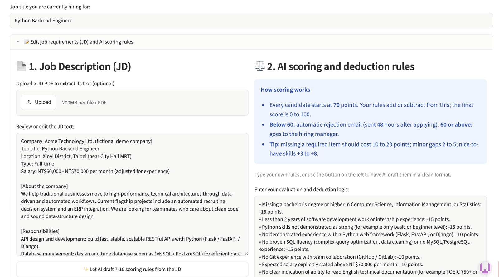
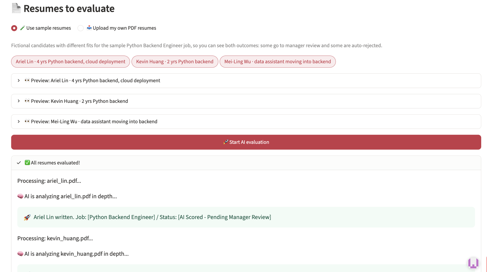
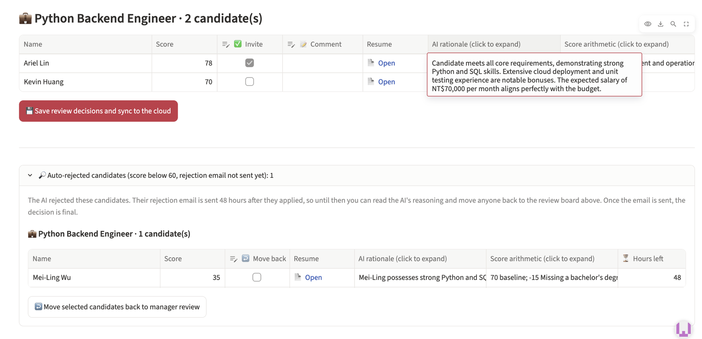
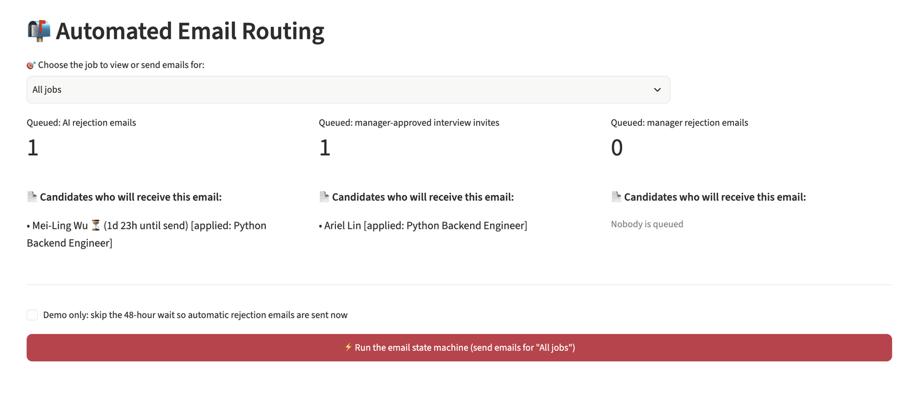
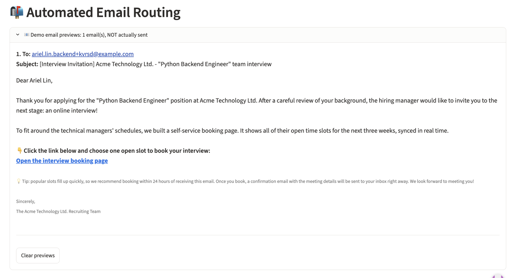
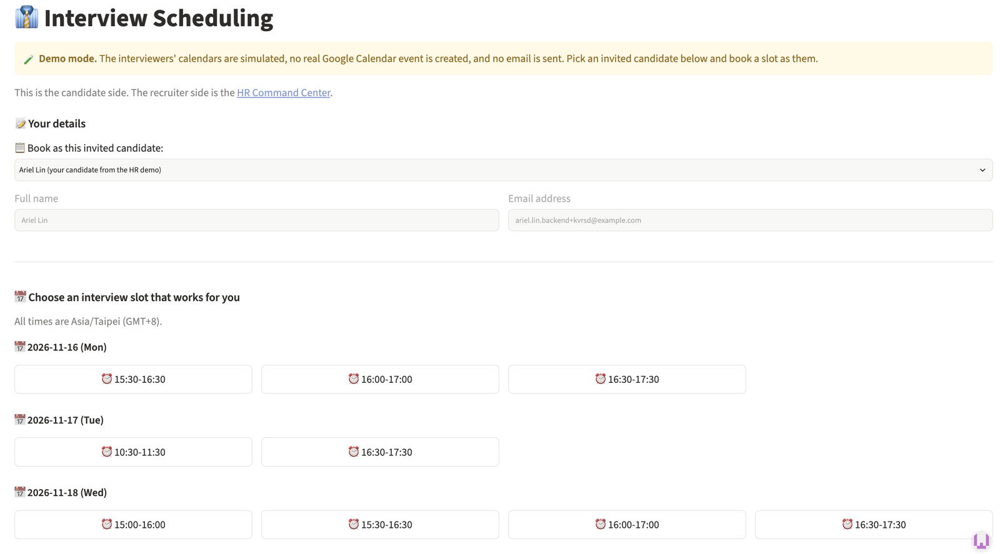
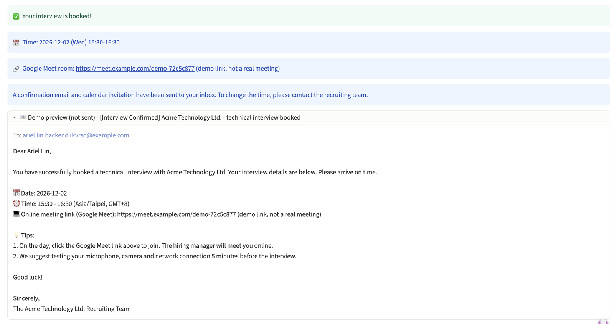
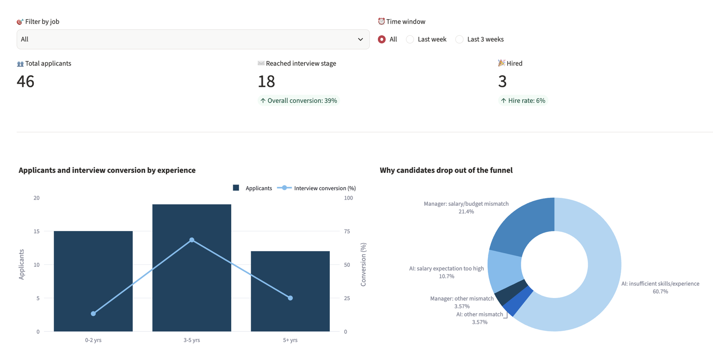
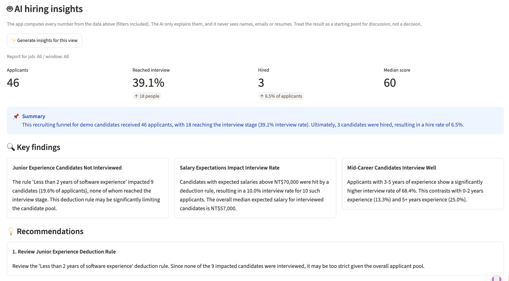

# AI Recruiting Automation System

An end-to-end recruiting workflow that screens resumes with AI, keeps a hiring manager in charge of every decision, lets candidates book their own interviews, and shows where the hiring funnel loses people.

**Live demo:** [HR Command Center](https://harper-hr-dashboard.streamlit.app/) · [Interview Booking](https://harper-interview-booking.streamlit.app/)
No sign-up and no files needed: sample resumes and candidates are built in.

> The demo apps sleep when idle. If you see a "gone to sleep" page, press the wake-up button and wait about 30 seconds.

## The problem

Before this project I worked in recruiting, first at a headhunting agency and then as a Talent Acquisition intern coordinating 40+ candidates a week. Three problems kept coming back:

1. **First-round screening is slow and inconsistent.** Every resume is read by hand, technical roles bring requirements that recruiters do not always have the background to judge, and two people screening for the same role do not always apply the same standard.
2. **Scheduling interviews is mostly back-and-forth.** Finding one slot that works for a candidate and several interviewers can take a chain of emails and calls for a single interview.
3. **Nobody can see where the funnel breaks.** Candidate records exist, but there is no simple view of where people drop out, whether the salary budget is realistic, or which requirements screen out most applicants.

## What this project changes

| | Before | With this system |
|---|---|---|
| **Screening** | Each recruiter reads every resume and judges it their own way | Every resume is scored against the same written rules; the AI shows which rules applied and the code adds up the points |
| **Decisions** | Rejections can happen without a second look | A hiring manager approves every interview, and can rescue anyone the AI rejected before the rejection email goes out |
| **Scheduling** | Emails back and forth to find a time | The candidate opens one link and picks a slot that is free for all interviewers; a video meeting is created automatically |
| **Candidate updates** | Candidates often wait without hearing back | Invitations, rejections and confirmations are sent based on each candidate's status |
| **Funnel visibility** | Data scattered across inboxes and spreadsheets | One dashboard shows drop-off by stage, rejection reasons, score vs. expected salary and which skills cost more |

The goal is not to let AI decide who gets hired. It is to take the repetitive work off recruiters so their time goes to the judgment calls, and to give the team data to improve the process.

## My role

I led a four-person course team ([full team below](#team)). My part:

- **Designed the workflow and the scoring method**: rules written from the job description, the AI reporting which rules apply, and the code computing every score.
- **Built the HR Command Center**: resume scoring, manager review, email routing and analytics, plus the Google Sheets, Gmail, Calendar and Drive integrations.
- **Redesigned interview scheduling** so candidates book a slot immediately instead of waiting for a batch schedule.
- **Integrated the team's work** (booking page, free-slot algorithm, charts) into one working system, and maintain the live demo.

## How it works

**1. The recruiter sets the screening rules.** Upload or paste a job description, and the AI drafts point-based scoring rules from it (for example, a deduction for a missing required skill). The recruiter reads, edits and saves them, so every resume is judged by the same written standard.



**2. Resumes are scored against those rules.** Upload a batch of PDF resumes (the demo also has built-in samples). The AI reports which rules applied, and the code adds up the score.



**3. The hiring manager decides.** Shortlisted candidates appear with the AI's reasoning and score arithmetic. Lower-scoring candidates wait in a separate list where the manager can move anyone back for review.



**4. Emails follow each candidate's status.** One click sends invitations and rejection notes (in the demo they are shown on screen, never sent).





**5. The candidate books the interview.** The link in the invitation opens a booking page that only offers times when every interviewer is free, then shows the confirmation with a video meeting link.





**6. The team sees where the funnel breaks**, with an optional AI-written summary of the numbers.





## Design choices

Each of these comes from a risk I wanted the system to avoid:

- **The AI screens, people decide who is interviewed.** The AI only filters out clear mismatches so the hiring manager, who understands the technical requirements, can focus on the rest. No one is invited without a manager's approval, and a manager who declines someone must write the reason, which then feeds the analytics. Low scorers are not rejected right away: for 48 hours a manager can read every deduction and move anyone back. If no one steps in, the rejection email is sent automatically.
- **The AI never does the math.** The model only reports which rules applied and their points; the code computes the score and decides the next step. An arithmetic slip or an unreadable answer cannot change a candidate's outcome. A wrong judgment by the model still can, which is why every adjustment is listed for the manager to check.
- **Rules are written down and editable.** Recruiters can read and change every rule, and the app warns about rules with no point values or rules too lenient to ever reject anyone.
- **The AI report never sees personal data.** The app computes every statistic first; the AI only explains aggregated numbers, never names, emails or resumes.

## What I learned

In November 2026, months after the course ended, the live demo suddenly stopped scoring resumes with the error `JSON mode is not enabled for api version v1`. The code had not changed. I could not work out the cause on my own, so I diagnosed it step by step with an AI assistant. The deployment log showed that the cloud host had installed version 3.0 of Google's AI library, a new major release whose default API version no longer supports the JSON output the app relies on, because `requirements.txt` accepted any version.

Following that diagnosis, I set the API version explicitly and capped the library below its next major version. The app had also been retrying this permanent error six times per resume, which used up the free daily quota, so it now stops at the first error that cannot succeed. I also saved the AI results for the sample resumes, so the demo keeps working when the quota runs out. Two lessons: code that depends on outside services needs pinned versions, explicit settings and a plan for when those services fail; and I want to be able to diagnose a failure like this myself, not only fix it with help.

## Try the demo

1. Open the **[HR Command Center](https://harper-hr-dashboard.streamlit.app/)**. A sample "Python Backend Engineer" job is already loaded: look over its job description and scoring rules, or press the AI button to draft new rules from the job description.
2. Under **Resumes to evaluate**, keep the three sample resumes selected (preview any of them), then press **Start AI evaluation**. When scoring is done, a summary appears; press **Go to Manager Review**.
3. Approve one candidate, decline another with a comment, and open **Auto-rejected candidates** to read the AI's reasoning or move someone back. Save the decisions, then press **Go to Email Routing**.
4. In **Email Routing**, press **Run the email state machine** to preview the emails (they are shown on screen, never sent). Tick "skip the wait" to include the automatic rejections.
5. Click the link in the invitation preview to book an interview as that candidate. You can also open the **[Interview Booking](https://harper-interview-booking.streamlit.app/)** page directly and pick one of the built-in invited candidates.
6. In **Analytics Dashboard**, sync the data, explore the charts and press **Generate insights** for the written report.

You can also upload your own PDF resumes. In demo mode no email is sent and no calendar event is created. Your candidates are visible only to you (a private code is kept in the page URL) and are deleted after 24 hours.

**Traditional Chinese:** add `?lang=zh` to either URL ([HR Command Center in Chinese](https://harper-hr-dashboard.streamlit.app/?lang=zh)), or use the language switch at the top of the page. English is always the default. In Chinese, the demo loads a Chinese sample job (Python 後端開發工程師) and four Chinese sample resumes, the AI writes its scoring reasons, drafted rules and analytics report in Chinese, the emails are in Chinese, and interview invitations open the booking page in Chinese. Status values in the sheet and the scoring arithmetic are the same in both languages.

## Limitations

This is a class project, not a production hiring system.

- **AI scores are a screening aid, not a decision.** They have not been validated for accuracy or tested for bias. A real deployment would need a bias audit and mandatory human review.
- **Scores can vary by a few points between runs**, so candidates near the threshold may land on either side of it.
- **Rule quality matters.** Overly strict rules (such as requiring specific degree majors) can screen out capable candidates, so a recruiter should always review them.
- **The public demo is shared.** All visitors use one Google Sheet and one free-tier Gemini key, so new AI requests may hit a "quota used up" message at busy times. The built-in sample resumes with the default rules keep working, because their AI results are saved in the repo. The demo's analytics use generated sample data, so its findings are illustrative.
- **Built for a demo, not for scale.** Google Sheets is the database, two simultaneous bookings can race, the rejection-reason chart uses keyword matching, and business hours and timezone (Taipei, GMT+8) are fixed in the code.

## Team

Built by a four-person student team for a "Programming for Business Computing" course.

| Name | Role |
|---|---|
| Te-Chi Chen (team lead) | Workflow design, scheduling workflow redesign (immediate booking), HR recruiting command center, team code integration |
| Qi Ding | Interview scheduling system web app design |
| Yi-Xuan Yang | Interviewer availability (free-slot) algorithm design |
| Rui-Yun Zhuang | Plotly chart design |

## Technical details

Built with Python, Streamlit, the Gemini API, Google Sheets, Google Calendar and Gmail.

<details>
<summary>Two apps, one workflow</summary>

| App | File | Audience | What it does |
|---|---|---|---|
| HR Command Center | `app.py` | Recruiters and hiring managers | AI resume parsing, manager review board, email routing state machine, analytics dashboard |
| Interview Booking | `streamlit_app.py` | Candidates | Reads the interviewers' Google Calendars, offers open 1-hour slots (15-minute buffer), prevents double booking, creates a Google Meet event, sends a confirmation email |

Google Sheets is the shared state store between them: each candidate is one row, and the `status` column drives the pipeline.

</details>

<details>
<summary>Status machine</summary>

```text
New resume (PDF) -> Gemini lists applied rules + points -> code computes 70 + sum -> score routing
  score >= 60 -> [AI Scored - Pending Manager Review] -> manager ticks the box
                    - approved   -> [Interview Invite Sent - No Reply] -> candidate books a slot
                                      -> [Interview Scheduled] -> HR sets [Hired] manually
                    - declined   -> [Rejection Email Sent]   (a comment explaining why is required)
  score <  60 -> [AI Scored - Pending Rejection Email] -> after 48 hours -> [Rejection Email Sent]
                    - manager moves the candidate back before then -> [AI Scored - Pending Manager Review]
```

If a hired candidate declines or takes another offer, HR can set `Offer Declined` by hand.

- **Status drives everything.** Routing and emails depend on `status`, not on the score, so a candidate the manager moves back follows the manager's decision.
- **Score and status are computed by code.** `scoring.py` sums the model's `adjustments` onto the baseline, clamps to 0-100 and stores the arithmetic in `score_calculation`; `app.py` derives the status from the score.
- **Duplicate guard.** A (job, email) pair already in the sheet is not written twice.
- **Interview slots.** Free time is the complement of all interviewers' busy blocks over the next 21 days, on weekdays within 09:00-12:00 and 13:00-18:00, shown on the hour and half hour.
- **One source for the scoring scale.** The baseline, threshold, delay and suggested point ranges are constants in `config.py`, read by both the UI and the AI prompts.
- **Error handling.** AI calls try up to three times with backoff on temporary errors (such as `503 UNAVAILABLE`), but stop immediately on permanent errors and quota limits so they do not waste the free quota.

</details>

<details>
<summary>Run it yourself</summary>

1. Follow [DEPLOYMENT_GUIDE.md](DEPLOYMENT_GUIDE.md) to create the Google Sheet, service account, OAuth token, Gmail app password and Gemini key. Set `DEMO_MODE = true` to skip the Gmail and Calendar parts.
2. Copy `secrets.example.toml` to `.streamlit/secrets.toml` and fill it in.
3. Install and run (two terminals):

```bash
pip install -r requirements.txt
streamlit run app.py                                  # HR Command Center, port 8501
streamlit run streamlit_app.py --server.port 8502     # candidate booking page
```

Unit tests cover the scoring arithmetic, rule checks, demo helpers and the analytics summary (`python -m unittest`). The Streamlit UI, Sheets, Calendar and email paths are tested by hand.

</details>

<details>
<summary>Google Sheet contract (for self-hosting)</summary>

The apps read and write columns by position, so the header row must be exactly:

| A | B | C | D | E | F | G | H | I | J | K | L | M | N | O | P | Q | R |
|---|---|---|---|---|---|---|---|---|---|---|---|---|---|---|---|---|---|
| status | job_applied | name | email | score | manager_approved | manager_comment | applied_at | action_at | interview_at | meeting_link | highest_education | total_experience_years | expected_salary | skills_extracted | score_reason | resume | score_calculation |

The `status` values are defined in `config.py` and must match the sheet exactly (use a data-validation dropdown on column A):

`AI Scored - Pending Manager Review`, `AI Scored - Pending Rejection Email`, `Rejection Email Sent`, `Interview Invite Sent - No Reply`, `Interview Invite Sent`, `Interview Scheduled`, `Hired`, `Offer Declined`

</details>

<details>
<summary>Project layout</summary>

```text
.
├── app.py                      # HR Command Center (4 tabs)
├── streamlit_app.py            # Candidate interview booking page
├── insights.py                 # Analytics statistics + prompt for the AI report (no personal data)
├── demo_support.py             # Demo-only helpers: visitor tags, sample candidates, cleanup plan
├── scoring.py                  # Pure score arithmetic + rule checks (unit tested)
├── i18n.py                     # English / Traditional Chinese text for both apps (?lang=zh)
├── tests/                      # Unit tests for scoring.py, demo_support.py, insights.py and the translations
├── config.py                   # Settings, scoring scale and the status-machine constants
├── calendar_busytime.py        # Reads interviewers' busy blocks (or simulates them in demo mode)
├── calendar_sync.py            # Creates the Calendar event + Google Meet link
├── clear_calendar_events.py    # Test helper: bulk-delete "[Interview]" events
├── apps_script/Code.gs         # Drive upload proxy (deploy as an Apps Script web app)
├── tools/generate_samples.py   # Regenerates the sample JD / resume PDFs
├── sample_jd/                  # Example job descriptions and the sample scoring rules (zh/: Chinese sample job)
├── sample_resumes/             # Six fictional candidate resumes (zh/: four Chinese ones)
├── jd.txt                      # Plain-text JD, preloaded as the demo's sample job
├── secrets.example.toml        # Every secret / setting the apps read
├── credentials.json.example    # Placeholder for the OAuth client file
├── requirements.txt
└── DEPLOYMENT_GUIDE.md
```

</details>

> Built with fictional data. "Acme Technology Ltd." is an invented company, and every sample resume describes an invented person.

## License

No license is specified yet; all rights reserved by the authors until one is added.
